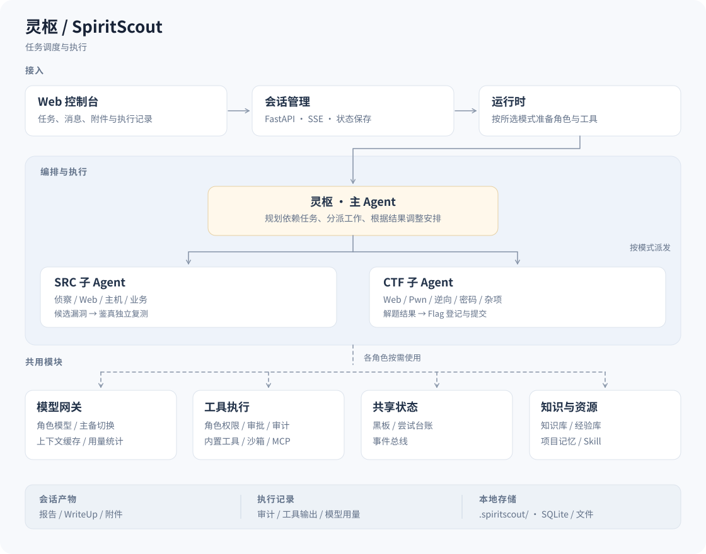

# 灵枢（SpiritScout）

灵枢用多个 Agent 协作完成安全测试，支持 SRC、CTF 和智能体竞赛。
你在网页上给出目标、附件和测试规则，主 Agent 分派任务，子 Agent 调用工具执行，
过程和结果都可以在会话里查看。


> tsecbench跑分记录（截止10.23,配合deepseek-v4.1-flash)

## 功能

- 多个子 Agent 并行处理任务，共享线索和尝试记录；候选漏洞交给独立 Agent 复测。
- 会话中可以补充消息、上传附件，展开工具调用查看详情，也可以查看任务拓扑。历史消息向上滚动自动读取，主时间线只保留三段内容渲染，移出的内容可向下滚动重读。
- 子 Agent 工作台显示各实例的活动；SRC 和普通 CTF 支持与子 Agent 单独对话。
- 按项目保存会话、资产和发现，生成渗透报告或 CTF WriteUp。
- 支持按角色选择模型、接入 MCP 和 Skill；仪表盘查看费用、Token 和输入缓存用量。

## 架构



用户在控制台选择模式、提交任务。会话管理负责消息、状态和执行记录，运行时按模式
准备 Agent 与工具。灵枢把目标拆成有依赖关系的任务，再根据执行结果调整后续安排。

子 Agent 负责具体操作，通过黑板共享资产、线索和结果，通过尝试台账记录已做过的工作。
图中的 SRC、CTF 是按模式选择的执行角色；智能体竞赛也会根据赛题和规则装配角色。
SRC 的候选漏洞由「鉴真」独立复测，报告和 WriteUp 根据会话记录汇总。

各角色通过同一个模型网关调用模型，可以分别指定模型。工具调用经过角色权限和审批检查，
再交给内置工具、沙箱或 MCP 执行，并留下审计记录。SRC 的危险操作需要人工批准，
CTF 和智能体模式自动审批。

知识库、经验库和项目记忆为 Agent 提供参考；会话状态、审计和产物保存在本地工作区。
模块划分和代码位置见 [架构文档](docs/02-架构总览与项目结构.md)。

## 安装

### Docker

Windows、Linux、macOS 均可通过 Docker 运行完整功能。需要 Linux 容器模式、
Docker Compose 2.20+；Windows/macOS 使用 Docker Desktop，Linux 使用 Docker Engine。
镜像未固定 CPU 架构。本次完成 Windows 与 amd64 Linux 验证，macOS/ARM64 未实测。

```bash
git clone https://github.com/FLIAZ/SpiritScout.git
cd SpiritScout
python deploy.py up
```

通用部署入口会检查 Docker、首次创建 `.env` 并生成随机管理员密码，构建并等待服务健康。
Windows 可将 `python` 换成 `py -3`，Linux/macOS 可换成 `python3`。
在项目 `.env` 中查看凭据，打开 <http://127.0.0.1:10010> 登录。

不使用 Python 部署入口时，也可手动复制 `.env.example` 为 `.env`，设置强密码后执行：

```bash
docker compose up -d --build
```

镜像包含 Chromium 和 bubblewrap；CTF 工具箱需要在 `.env` 中设置 `INSTALL_TOOLKIT=1` 后构建。

查看日志用 `python deploy.py logs`，停止用 `python deploy.py down`（保留数据卷）。
SRC 人工接管浏览器用 `python deploy.py up --browser`。
默认使用镜像内源码，配置和运行数据保存在独立 Docker 卷。
**旧版部署升级前先停服迁移**，见 [升级与数据迁移](docs/部署与配置.md#升级与数据迁移)。

### 本地运行

原生控制台支持 Windows、Linux、macOS；完整 shell/Python 沙箱执行需要 Linux 与
bubblewrap，Windows/macOS 推荐使用上面的 Docker 部署。原生浏览器工具需要
Node.js 22+、Chromium 或 Google Chrome；Windows/macOS 的标准 Chrome 安装位置会自动识别。

```bash
git clone https://github.com/FLIAZ/SpiritScout.git
cd SpiritScout
python3 -m venv .venv
.venv/bin/pip install -e '.[toolkit]'
```

Linux 安装 bubblewrap（按发行版选一个）：

```bash
sudo apt install bubblewrap   # Debian / Ubuntu
sudo dnf install bubblewrap   # Fedora
```

```bash
./launch.sh
```

Windows 原生控制台使用 PowerShell：

```powershell
py -3 -m venv .venv
.venv\Scripts\python.exe -m pip install -e .
.\launch.ps1
```

macOS/Linux 使用上面的 `.venv/bin/python` 与 `launch.sh`。各平台的虚拟环境不要混用；
Windows 原生与 WSL 如需同时开发，应使用不同工作副本或虚拟环境目录。

打开 <http://127.0.0.1:8000>。默认在前台运行，按 `Ctrl+C` 停止。
可以用 `./launch.sh --port 10010` 修改端口。需要远程访问时，先配置
[管理员凭据](docs/部署与配置.md#管理员登录)，再通过 `--host 0.0.0.0` 监听外部地址。

## 使用

1. 在「模型」页添加供应商地址、API Key 和模型 ID。
2. 在「编队」页为灵枢及子 Agent 指派模型。
3. 回到首页，选择 SRC、CTF 或智能体竞赛，填写目标和规则，附上需要的文件，点击「开始执行」。

SRC 模式下，危险操作需要你批准。CTF 和智能体模式自动批准工具操作并保留审计记录；
智能体模式用于无人值守竞赛，不向用户提问，也不使用公开网页搜索。
任务模式由你选择，项目中保存的历史资产不会自动成为本次测试的授权目标。

CTF 和智能体模式使用会话独立的无头浏览器。SRC 可以连接已有浏览器复用登录态，
也可以启用项目提供的浏览器容器，遇到登录或验证码时手动接管。
配置方法见 [浏览器说明](docs/部署与配置.md#浏览器)。

原生部署的会话、审计和报告保存在 `.spiritscout/`，Docker 部署保存在对应数据卷。
API Key 加密保存在部署工作区，
模型调用和付费搜索产生的费用由所接入的服务收取。仪表盘中的费用是估算值，
缓存命中率取自供应商返回的用量，具体扣费以供应商账单为准。
可用 `.venv/bin/python scripts/token_report.py` 只读查看当前版本的 token 基线；
失败/取消尝试与成功响应分列，未知用量不冒充零。短补丁优化默认关闭；新对话共享前缀与
显式真实对照方法见 [缓存优化与测试](docs/05-核心算法与技术实现.md#稳定前缀与测试修复0122)。

## 文档

当前版本 **v0.12.4**。版本采用 `主版本.次版本.修订号`，历史功能阶段已在
[更新日志](CHANGELOG.md) 中回溯整理；后续递增规则见 [版本管理](CONTRIBUTING.md#版本管理)。

- [部署与配置](docs/部署与配置.md)：管理员登录、浏览器、MCP、搜索和数据备份。
- [项目文档](docs/README.md)：架构、任务流程和代码索引。
- [更新日志](CHANGELOG.md)
- [贡献指南](CONTRIBUTING.md)
- [安全问题反馈](SECURITY.md)

## 开发

后端使用 Python、FastAPI 和 SQLite，前端是原生 HTML/CSS/JS，没有构建步骤。
后端代码在 `src/spiritscout/`，前端在 `src/spiritscout/web/static/`。

```bash
.venv/bin/pip install -e '.[dev]'
LITELLM_LOCAL_MODEL_COST_MAP=True .venv/bin/python -m unittest discover tests/
.venv/bin/python -m ruff check src/ tests/
for f in src/spiritscout/web/static/js/*.js; do node --check "$f" || exit; done
for f in tests/test_*.js; do node "$f" || exit; done
```

## 许可证

[Apache License 2.0](LICENSE)。引用的知识库、Skill 和外部工具遵循各自的许可证。

## 法律免责声明 & 使用合规须知

### 1. 工具定位

本项目（以下简称「本工具」）为网络安全学术研究、授权安全测试、企业内部风险自查用途的开源技术工具。

本工具所有功能仅面向拥有合法授权的测试场景，旨在提升网络安全防御能力、助力漏洞合规治理、推进安全技术学术研究。

### 2. 严格授权使用原则

所有使用者必须提前获得目标系统的书面合法授权。

严禁在无授权、越权、超范围情况下，对以下对象进行扫描、探测、渗透、数据获取、流量分析、自动化测试：

- 互联网公网任意未授权系统
- 金融、能源、政务、运营商、交通等关键信息基础设施
- 第三方企业、个人、公有云任意业务系统
- 任何法律法规禁止测试的信息系统

未授权测试即属于违法行为，使用者自行承担全部法律责任。

### 3. 禁止滥用条款

所有使用者承诺：

1. 不得利用本工具实施非法入侵、非法控制、数据窃取、流量攻击、漏洞滥用等违法犯罪行为；
2. 不得将本工具用于黑产、牟利、恶意破坏、未授权批量扫描、网络骚扰等场景；
3. 不得绕过、破解本工具内置的安全限制、黑白名单风控机制用于非法用途；
4. 不得用于危害国家网络安全、扰乱公共秩序、侵犯他人合法权益的活动。

### 4. 责任边界（核心免责）

1. 项目开源作者、维护团队、贡献者：仅提供公开的技术代码与学术实现，不参与、不知情、不协助任何第三方的非法使用行为，不对第三方滥用产生的任何后果承担刑事、行政、民事连带责任。
2. 本工具技术中立，合法合规用途明确，任何使用者的违法操作均为独立个人行为，与项目作者无关。

### 5. 强制合规义务

使用者使用本工具即默认表示：

- 已充分知晓《中华人民共和国网络安全法》
- 已充分知晓《中华人民共和国刑法》第285条、第286条相关规定
- 已具备合法网络安全测试资质或授权资质
- 自愿承担所有使用风险及法律后果

### 6. 违规处置机制

项目团队保留以下权利：

- 随时关停仓库、终止分发、更新风控限制
- 举报、记录、留存恶意滥用行为证据
- 拒绝为非法使用者提供任何技术答疑、指导、更新、协助

### 7. 最终声明

本工具严禁非法滥用。任何违法使用行为，由行为人独立承担全部法律责任，与项目开发、维护、贡献团队无关。

## 致谢

### 知识库数据来源

- [PayloadsAllTheThings](https://github.com/swisskyrepo/PayloadsAllTheThings)（MIT）——载荷与方法论主体来源，按本项目条目结构重写并补充靶场实测验证
- [NoorQureshi/security-skills](https://github.com/NoorQureshi/security-skills)（MIT）——206 条安全技能（Web/云/AD/移动/逆向/社工），原样接入供智能体检索

### 参考项目

- [carlospolop/HackTricks](https://github.com/carlospolop/HackTricks)（CC BY-NC-SA）——方法论思路参考
- [OWASP WSTG](https://github.com/OWASP/wstg)（CC BY-SA-4.0）——测试标准思路参考
- [GTFOBins](https://github.com/GTFOBins/GTFOBins.github.io)（GPL-3.0）——Unix 二进制利用思路参考
- [VoltAgent/awesome-agent-skills](https://github.com/VoltAgent/awesome-agent-skills)（MIT）——智能体技能目录（1000+ 条）

### 项目使用的 MCP 服务器

项目配置和示例涉及以下 MCP 服务器，是否启用以本机配置为准：

| MCP | 许可 | 用途 |
| --- | --- | --- |
| [ida-pro-mcp](https://github.com/mrexodia/ida-pro-mcp) | 自定义 | 逆向：反编译 / 交叉引用 / 函数与类型检索（无头 idalib） |
| [yakit](https://github.com/yaklang/yakit) | 自定义 | Web 渗透：编解码 / HTTP 流量 / 模糊测试 / 指纹 / 端口 / 反序列化 |
| [playwright-mcp](https://github.com/microsoft/playwright-mcp) | Apache-2.0 | 浏览器自动化：JS 渲染 DOM / 点击 / 表单 / 截图 |
| pentester-mcp | 自定义 | 渗透工具集：nmap / nuclei / sqlmap / ffuf / impacket / hydra |
| burp-mcp | 自定义 | Web 漏洞扫描与模糊测试（PortSwigger 官方扩展） |
| shodan-mcp | MIT | 资产情报（出网至第三方服务） |
| virustotal-mcp | MIT | 文件 / 域名情报（VirusTotal 官方托管端点） |

### 技能源

- [obra/superpowers](https://github.com/obra/superpowers)（MIT）——通用工程方法论技能集
- [anthropics/skills](https://github.com/anthropics/skills)——SKILL.md 格式规范参考（无 LICENSE，仅格式参考，内容未使用）
- [VoltAgent/awesome-agent-skills](https://github.com/VoltAgent/awesome-agent-skills)（MIT）——智能体技能目录（1000+ 条）

### 用户

- [@BProbie](https://github.com/BProbie)：修正文档格式
- [@k1ne](https://github.com/k1ne7)：多平台兼容功能
- [@neko](https://github.com/neko-11451)：对登录页的前端美化

## Star History

<a href="https://www.star-history.com/?repos=fliaz%2Fspiritscout&type=date&legend=top-left">
 <picture>
   <source media="(prefers-color-scheme: dark)" srcset="https://api.star-history.com/chart?repos=fliaz/spiritscout&type=date&theme=dark&legend=top-left" />
   <source media="(prefers-color-scheme: light)" srcset="https://api.star-history.com/chart?repos=fliaz/spiritscout&type=date&legend=top-left" />
   
 </picture>
</a>
