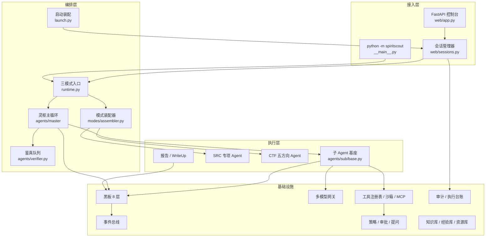
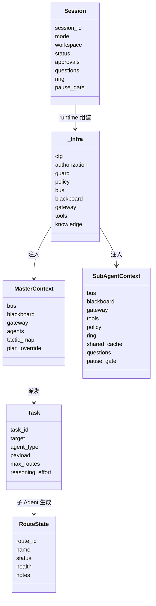

# 02 · 架构总览与项目结构

## 2.1 分层架构

系统可以按“接入 → 编排 → 执行 → 基础设施”四层理解。下层不依赖上层，编排层通过依赖注入拿到基础设施句柄。



关键边界：

- **Web 层不直接调模型或工具**。它只做请求校验、会话管理、SSE、认证与静态资源；真正执行在 `runtime.py`。
- **主 Agent 不直接执行工具**。它派发任务包；执行者通过 `AgentToolView` 收窄后的工具目录行动。
- **基础设施由 `_build_infra` 统一组装**，失败路径统一回收，避免资源泄漏（[runtime.py](../src/spiritscout/runtime.py#L219-L582)）。

## 2.2 模块职责表

| 模块 | 职责 | 关键入口 | 备注 |
| --- | --- | --- | --- |
| `web/app.py` | FastAPI 应用工厂、50 个 app 路由（另有 resources/projects 路由）、认证中间件、SSE | `create_app` L345 | 统一安全边界在 L405-L445 |
| `web/sessions.py` | 会话注册、隔离工作区、创建/停止/暂停/续传/删除 | `SessionManager` L948 | 每会话一份配置副本 L1128 |
| `web/events.py` | 审计 JSONL 的 SSE 与历史分页 | `read_audit_page` / `stream_audit` | 字节游标，断线可 seek |
| `launch.py` | 授权/目标/赛题/赛制/平台档案的唯一装配入口 | `prepare_launch` L187 | 模式前置校验，不静默降级 |
| `runtime.py` | 三模式运行入口、基建组装、收尾 | `run_engagement` L1174 等 | 报告/提炼/回收 |
| `agents/master/` | 灵枢：LangGraph 状态机 + DAG + 复盘 + 用户直达 | `MasterAgent` L99 | 4 节点，外层分段循环 |
| `agents/sub/base.py` | 子 Agent 基座：路线规划/并行执行/健康度/上报 | `SubAgent` L182 | 路线是交付目标 |
| `agents/profiles.py` | 角色档案与工具权限单一事实源 | `PROFILES` L49 | 页面/提示词/运行时共用 |
| `agents/verifier.py` | 鉴真：独立复测与证据核对 | `VerifierAgent` L49 | 只收 confirmed |
| `agents/ring.py` | 环形台账：尝试登记 + 督导 | `RingLedger` L34 | 进程内，随会话消亡 |
| `ctf/agents.py` | CTF 五方向解题环 | `CTFBaseAgent` L485 | 持久工具调用对话 |
| `ctf/flags.py` | Flag 提取/登记/提交/退避 | `FlagManager` L53 | 模型判定优先 |
| `ctf/platform.py` | 平台档案解析与适配器 | `PlatformAdapter` L262 | 声明式接口映射 |
| `blackboard/` | 8 层存储、写权限、outbox、汇聚 | `Blackboard` L55 / `ConvergenceEngine` L33 | SQLite WAL + 版本锁 |
| `gateway/` | 多模型网关、协议、上下文、用量 | `ModelGateway` L174 | LiteLLM 三协议 |
| `policy/` | 范围标注、风险门、审批、提问 | `PolicyEngine` L53 | G1/G2/G3/G5 |
| `tools/` | 注册表、执行器、沙箱、MCP、台账 | `ToolRegistry` L47 | 所有调用先过策略门 |
| `knowledge/` | 五库 + 两经验库、FTS5、语义索引 | [store.py](../src/spiritscout/knowledge/store.py) | 种子数据 seed.py |
| `resources/` | MCP/Skill 安装、项目分区、共享资产 | `ResourceStore` | 加密配置 catalog.key |
| `modes/` | SRC/CTF/渗透赛装配 | `ModeAssembler` L188 | 赛制不裁剪角色 |
| `competition/` | 赛制规则与调度引擎 | `CompetitionEngine` L59 | 部分为骨架/遗留 |
| `traffic/` | HAR 导入与脱敏 | `parse_har` L95 | 不存 Cookie/正文 |
| `core/` | 数据模型、审计、暂停、异常 | `core/models.py` | pydantic v2 |

## 2.3 目录结构

```text
SpiritScout/
├── src/spiritscout/
│   ├── agents/
│   │   ├── master/          # 灵枢状态机、DAG
│   │   ├── sub/             # 子 Agent 基座、健康度、共享缓存
│   │   ├── hostops/         # 听风/贯甲/深耕
│   │   ├── recon/ webvuln/ business/ report/
│   │   ├── verifier.py secretary.py ring.py profiles.py roster.py
│   ├── ctf/                 # 五方向 Agent、Flag、平台、WriteUp
│   ├── blackboard/          # 8 层黑板、汇聚
│   ├── bus/                 # inprocess/redis/nats
│   ├── gateway/             # 网关、后端、上下文、世界状态、用量
│   ├── policy/              # scope/engine/approvals/questions
│   ├── tools/               # registry/executor/sandbox/mcp/journal
│   ├── knowledge/           # FTS5 五库两经验库、种子、语义
│   ├── resources/           # MCP/Skill、项目、资产、加密配置
│   ├── modes/               # 模式装配器
│   ├── competition/         # 赛制规则、引擎、策略
│   ├── traffic/             # HAR
│   ├── web/                 # FastAPI + static 前端
│   ├── runtime.py launch.py __main__.py
├── tests/                   # 56 个 py + 10 个 js 测试文件
├── configs/                 # system.yaml / models.yaml / 示例
├── docs/                    # 本文档
├── Dockerfile docker-compose.yml launch.sh
├── .github/workflows/ci.yml
```

规模（2026-10-24 统计）：

| 类别 | 文件数 | 行数 |
| --- | --- | --- |
| 后端 Python | 109 | 26,871 |
| 前端 JS | 14 | 4,120 |
| 前端 CSS | 6 | 1,617 |
| 测试 Python | 56 | 10,233（另有 10 个 JS 测试） |

## 2.4 核心对象模型

一次任务不是“一个函数调用”，而是一组对象的协作。理解这些对象，比记函数名更重要。



- `_Infra` 定义在 [runtime.py](../src/spiritscout/runtime.py#L135-L192)，所有会话级资源（总线、黑板、网关、工具、知识库、MCP、暂停门、审批/提问）都在这里。
- `SubAgentContext.for_agent()` 会按角色绑定模型、收窄工具视图，并给 MCP 工具一个活视图（[agents/sub/base.py](../src/spiritscout/agents/sub/base.py#L119-L160)）。
- `RouteState` 的健康度、风险分、步数、笔记是剪枝与拓扑展示的数据源（[core/models.py](../src/spiritscout/core/models.py#L253-L275)）。

## 2.5 数据落点

所有运行数据默认在 `.spiritscout/`，Web 会话再按会话隔离。

| 文件/目录 | 内容 | 代码 |
| --- | --- | --- |
| `.spiritscout/sessions/sess-*/` | 单会话工作区 | `web/sessions.py:1128-1157` |
| `bb.db` | 8 层黑板（SQLite WAL） | `blackboard/store.py` |
| `audit.jsonl` | 审计事件（原文） | `core/audit.py` |
| `usage.db` + `usage.json` | 逐笔用量账本与旧格式兼容 | `gateway/usage.py` |
| `flags.json` | Flag 候选与提交结果 | `ctf/flags.py` |
| `meta.json` | 会话元数据、状态、对话史、暂停扣账 | `web/sessions.py:1083-1104` |
| `browser-output/` | 浏览器截图等产物 | `runtime.py:415-421` |
| `attachments/` | 用户附件（只读挂入沙箱） | `runtime.py:373-385` |
| `sandbox/` | 沙箱持久工作目录 | `tools/sandbox.py:264-269` |
| `artifacts/` | 交付产物（可写挂入沙箱） | `tools/sandbox.py:270` |
| `reports/` | 报告 / WriteUp | `agents/report/agent.py` |
| `experience_distill/` | 后台提炼快照 | `runtime.py:998-1060` |
| `.spiritscout/vault.db` + `vault.key` | 模型供应商密钥密文与主密钥 | `web/vault.py` |
| `.spiritscout/resources/catalog.db` | 共享资产、项目、MCP/Skill 配置 | `resources/store.py` |
| `.spiritscout/knowledge.db` | 五库 + 两经验库（FTS5） | `knowledge/store.py` |
| `.spiritscout/experience.db` | 跨会话经验库 | `knowledge/experience.py` |
| `admin.db` + `auth.key` | 管理员 scrypt 哈希与 Cookie 签名密钥 | `web/auth.py` |
| `execution.key` | 执行台账结果加密密钥 | `tools/journal.py` |

> 注意：`.spiritscout/` 在版本库外，但不是加密目录。审计与黑板按设计原文落盘，信任边界是本机文件系统（见 04）。

## 2.6 配置体系

| 文件 | 用途 | 关键字段 |
| --- | --- | --- |
| `configs/system.yaml` | 主配置 | workspace、bus、gateway、executor、knowledge、web、mcp_servers、routes |
| `configs/models.yaml` | 供应商 + 模型注册表 | providers、models、成本、上下文、思考档位 |
| `configs/agent_models.yaml` | 角色→模型指派（运行时生成/编队页维护） | master/verifier/secretary/… |
| `.env` | 管理员凭据、Chrome CDP、Redis 等 | `SPIRITSCOUT_ADMIN_USERNAME/PASSWORD` |
| 环境变量覆盖 | `SPIRITSCOUT_<SECTION>__<KEY>` | 双下划线分层（[config/settings.py](../src/spiritscout/config/settings.py#L42-L58)） |
| `models_config_path` | 模型配置路径 | 默认 `configs/models.yaml` |

配置加载是**加载即校验**：未知字段、非法数值、重复模型 ID 都会直接报错（`extra="forbid"`，[config/settings.py](../src/spiritscout/config/settings.py#L64-L68)）。这是防止“配置写错但静默生效”的重要设计。

## 2.7 部署形态

### 本地 Python（Linux/WSL）

```bash
python3 -m venv .venv && .venv/bin/pip install -e '.[toolkit]'
./launch.sh                 # 默认 127.0.0.1:8000
./launch.sh stop            # 有运行中会话时拒绝，需 --force
```

沙箱依赖 bubblewrap。`launch.sh` 只是启动器，真正入口是 `python -m spiritscout`（[launch.sh](../launch.sh)、[__main__.py](../src/spiritscout/__main__.py#L71-L112)）。

### Docker

```bash
cp .env.example .env
docker compose up -d --build
```

- 镜像内置 Python 3.11、bubblewrap、Node 22 与固定版本 `@playwright/mcp@0.0.83`（[Dockerfile](../Dockerfile#L30-L57)）。
- 源码以 `./:/app` 挂载，改代码即时生效。
- 只发布到宿主机回环 `127.0.0.1:10010`。
- **关键安全权衡**：为了让容器内的 bwrap 创建命名空间，compose 给容器 `SYS_ADMIN`、`seccomp=unconfined`、`apparmor=unconfined`（[docker-compose.yml](../docker-compose.yml#L44-L49)）。这等于放开了容器的一部分隔离能力，**不要把该容器当成强隔离边界**；更强隔离需要 rootless 方案或把执行器放到独立主机。

### 单实例约束

同一时间只应启动一个实例监听同一端口；`ExecutionRunLock` 在运行期对工作区加锁，防止两个进程同时写同一黑板（[tools/run_lock.py](../src/spiritscout/tools/run_lock.py)）。

## 2.8 依赖与版本

- Python `>=3.11`，CI 覆盖 3.11 / 3.14。
- 核心依赖：pydantic、pyyaml、jinja2、httpx、litellm、langgraph、fastapi、uvicorn、cryptography、mcp。
- 可选：toolkit（pwntools/pycryptodome/z3/scapy/binwalk/sqlmap）、redis、nats、chroma、report。
- 前端零依赖、零构建；修改后只需 `node --check`。
- CI：Ubuntu 24.04，ruff + compileall + unittest + `node --check` + JS 测试（[.github/workflows/ci.yml](../.github/workflows/ci.yml)）。

## 2.9 架构上的取舍与代价

| 取舍 | 好处 | 代价 |
| --- | --- | --- |
| 单进程 + SQLite | 部署简单、事务强一致、调试容易 | 并发上限低（默认 4 会话），难横向扩展 |
| 前端无构建 | 改完即生效、无 Node 工具链 | 单文件膨胀（`views.js` 约 1,574 行），缺少组件化 |
| 模型上下文维护边界 | 边界可理解、可随用户答复变化 | 无确定性阻断保证，模型可能越界 |
| 黑板原文落盘 | 可审计、可复盘、可导出 | 共享主机上有敏感数据暴露风险 |
| 动态 DAG + 无回合顶 | 复杂任务可长时间推进 | 成本不可预测，依赖模型收敛能力 |
| MCP 动态接入 | 工具生态可扩展 | 外部工具风险与稳定性不可控，握手失败需降级 |

这些取舍在 04（安全）与 08（不足）会展开。
